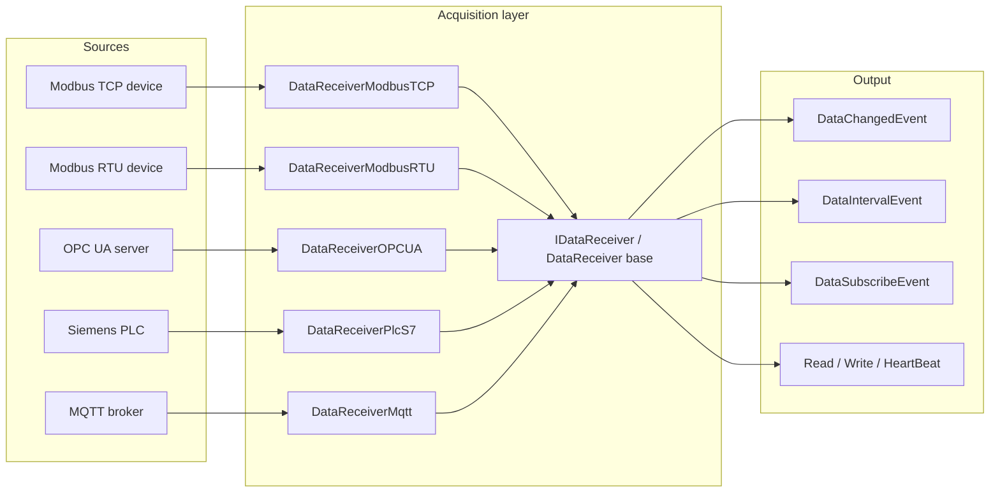

# iml6yu.Data · Multi-Protocol Industrial Data Acquisition & Data Service Library

English | [简体中文](README.md)

[](LICENSE)

[](https://github.com/iml6yu-tool/data_receiver/stargazers)
[](https://github.com/iml6yu-tool/data_receiver/issues)
[](https://github.com/iml6yu-tool/data_receiver/commits/main)

> A unified `DataReceiver` and `DataService` library for .NET 6/7/8/9/10.
> One abstraction, multiple protocols: **Modbus TCP / Modbus RTU / OPC UA / Siemens S7 / MQTT**.

---

## Table of contents

- [Introduction](#introduction)
- [Features](#features)
- [Supported protocols](#supported-protocols)
- [Architecture](#architecture)
- [Repository layout](#repository-layout)
- [Quick start](#quick-start)
- [Configuration](#configuration)
- [Core API](#core-api)
- [Events](#events)
- [Detailed usage rules](#detailed-usage-rules)
- [DataService](#dataservice)
- [Examples](#examples)
- [Build](#build)
- [FAQ](#faq)
- [Contributing](#contributing)
- [License](#license)

---

## Introduction

`data_receiver` provides a single abstraction for industrial data acquisition. Whether the underlying device speaks Modbus, OPC UA, Siemens S7 or MQTT, application code works against the same `IDataReceiver` interface for **connection, polling, caching, reading, writing, subscriptions and event callbacks**.

The solution also ships `DataService`, which exposes data as a **Modbus TCP/RTU slave** or an **OPC UA server** for commissioning, write-back and simulation.

Design goals:

- **Protocol-agnostic** — business code depends only on the unified interface and data contracts.
- **Ready to use** — integrates with `Microsoft.Extensions.DependencyInjection`, `ILogger` and `IConfiguration`.
- **Configuration-driven** — connection parameters and nodes are defined in JSON and can be loaded or reloaded on demand.
- **Reliable** — built-in automatic reconnection, data cache, change detection, heartbeat checks and a bounded message channel.

---

## Features

| Feature | Description |
| --- | --- |
| Unified abstraction | `IDataReceiver` / `IDataReceiver<TClient, TOption>` hides protocol differences |
| Multiple protocols | Modbus TCP, Modbus RTU, OPC UA, Siemens S7, MQTT |
| Dependency injection | Each protocol package provides `AddReceiver(...)` / `AddMqttReceiver(...)` |
| Automatic reconnect | `StartWorkAsync` keeps checking the connection and reconnects by `ReConnectPeriod` |
| Data cache | Latest value and timestamp cached per address; `ReadAllAsync` / `ReadAsync` / `ReadsAsync` |
| Change detection | `DataChangedEvent` fires only when a value changes |
| Scheduled polling | Reads per-node `Interval` and raises `DataIntervalEvent` |
| Subscriptions | `Subscribe(key, addresses)` per business key; up to 20 keys, 100 addresses each |
| Read/write | Batch write, single write and write-with-verify (`WriteWithVerifyAsync`) |
| Heartbeat | `Healthy / Degraded / Unavailable` based on a configured heartbeat node |
| Bounded channel | Internal `Channel` of 5000 items; drops the oldest and logs a warning when full |
| Multi-targeting | `net6.0` / `net7.0` / `net8.0` / `net9.0` / `net10.0` |
| Data services | Modbus TCP/RTU slave and OPC UA server with defaults and heartbeat writes |

---

## Supported protocols

### Acquisition (DataReceive)

| NuGet package | Protocol | Underlying dependency | Description |
| --- | --- | --- | --- |
| `iml6yu.DataReceive.Core` | - | `iml6yu.License` | Core abstraction, options, cache and events |
| `iml6yu.DataReceive.ModbusMaster` | Modbus | `NModbus` 3.0.81 | Shared Modbus read models and types |
| `iml6yu.DataReceive.ModbusMasterTCP` | Modbus TCP | `NModbus` | Modbus TCP master acquisition |
| `iml6yu.DataReceive.ModbusMasterRTU` | Modbus RTU | `NModbus.Serial`, `System.IO.Ports` | Modbus RTU serial acquisition |
| `iml6yu.DataReceive.OPCUA` | OPC UA | `OPCFoundation.NetStandard.Opc.Ua.Client` 1.5.377.22 | OPC UA client acquisition |
| `iml6yu.DataReceive.PLCSiemens` | Siemens S7 | Bundled `S7.Net` sources | Siemens S7 PLC acquisition |
| `iml6yu.DataReceive.Mqtt` | MQTT | `MQTTnet` 5.x (net8+) / 4.3.7 (net6/7) | MQTT subscription with a custom payload parser |
| `iml6yu.DataReceive.Mqtt.Default` | MQTT | Same as above | Parses the default `DataReceiveContract` JSON |
| `iml6yu.DataReceive.Mqtt.InPlant` | MQTT | Same as above | Parses the Supcon InPlant payload |

### Data services (DataService)

| NuGet package | Service type | Description |
| --- | --- | --- |
| `iml6yu.DataService.Core` | - | `IDataService` interface and option models |
| `iml6yu.DataService.Modbus` | Modbus | Shared Modbus slave implementation and data store |
| `iml6yu.DataService.ModbusTCP` | Modbus TCP slave | Exposes data as a Modbus TCP slave |
| `iml6yu.DataService.ModbusRTU` | Modbus RTU slave | Exposes data as a Modbus RTU slave |
| `iml6yu.DataService.OpcUa` | OPC UA server | Exposes data as OPC UA nodes |

---

## Architecture



Data flow: **acquire → type validation → cache update (change detection) → bounded channel → event dispatch**.

---

## Repository layout

```
iml6yu.Data
├── doc/                             # Additional documentation
├── src/
│   ├── iml6yu.Data.sln              # Solution
│   ├── Directory.Build.props        # Target frameworks and version
│   ├── iml6yu.DataCore/             # Data contracts and shared models
│   │   └── iml6yu.Data.Core/
│   ├── iml6yu.DataReceive/          # Acquisition implementations
│   │   ├── Docs/                              # In-depth guides (Chinese)
│   │   ├── iml6yu.DataReceive.Core/           # Core abstraction
│   │   ├── iml6yu.DataReceive.ModbusMaster/   # Shared Modbus models
│   │   ├── iml6yu.DataReceive.ModbusMasterTCP/
│   │   ├── iml6yu.DataReceive.ModbusMasterRTU/
│   │   ├── iml6yu.DataReceive.OPCUA/
│   │   ├── iml6yu.DataReceive.PLCSiemens/
│   │   ├── iml6yu.DataReceive.Mqtt/
│   │   ├── iml6yu.DataReceive.Mqtt.Default/
│   │   └── iml6yu.DataReceive.Mqtt.InPlant/
│   ├── iml6yu.DataService/          # Data service implementations
│   │   ├── iml6yu.DataService.Core/
│   │   ├── iml6yu.DataService.Modbus/
│   │   ├── iml6yu.DataService.ModbusTCP/
│   │   ├── iml6yu.DataService.ModbusRTU/
│   │   └── iml6yu.DataService.OpcUa/
│   ├── iml6yu.Database/             # Database constants
│   ├── examples/                    # Runnable examples
│   └── test/                        # Test and verification projects
├── LICENSE
└── README.md
```

The version is maintained in [Directory.Build.props](src/Directory.Build.props) and is currently `2.0.2-beta261126001`.

---

## Quick start

### Requirements

- .NET SDK 10.0 (the libraries multi-target up to `net10.0`; .NET 8 SDK is enough to run the examples)
- Network access to the target device or service

### 1. Install the NuGet package

Modbus TCP as an example:

```bash
dotnet add package iml6yu.DataReceive.ModbusMasterTCP
```

Install other protocols as needed:

```bash
dotnet add package iml6yu.DataReceive.ModbusMasterRTU
dotnet add package iml6yu.DataReceive.OPCUA
dotnet add package iml6yu.DataReceive.PLCSiemens
dotnet add package iml6yu.DataReceive.Mqtt
```

> If a package version is not available on NuGet, reference the corresponding project in this repository directly.

### 2. Register the receiver (dependency injection)

```csharp
using iml6yu.DataReceive.ModbusMasterTCP;
using iml6yu.DataReceive.ModbusMasterTCP.Configs;

var builder = Host.CreateApplicationBuilder(args);

var option = builder.Configuration
    .GetSection("DataReceiverOption")
    .Get<DataReceiverModbusTCPOption>();

// isAutoLoadNodeConfig = true: load node configuration from option.NodeFile
builder.Services.AddReceiver(option, isAutoLoadNodeConfig: true);
builder.Services.AddHostedService<Worker>();

var host = builder.Build();
host.Run();
```

### 3. Configuration file

`appsettings.json`:

```json
{
  "Logging": {
    "LogLevel": {
      "Default": "Information",
      "Microsoft.Hosting.Lifetime": "Information"
    }
  },
  "DataReceiverOption": {
    "originName": "",
    "originPwd": "",
    "originHost": "127.0.0.1",
    "originPort": 502,
    "reConnectPeriod": 10000,
    "reConnectTimes": 2,
    "connectTimeout": 60000,
    "receiverName": "warn_receiver",
    "nodeFile": "config/L01_P4.json",
    "autoConnect": false
  }
}
```

### 4. Node configuration

`config/L01_P4.json`:

```json
[
  {
    "fullAddress": "1.ReadInputRegisters2.0",
    "address": "CheckResults",
    "valueType": "Int32",
    "interval": 300,
    "groupName": "L01",
    "descript": ""
  }
]
```

### 5. Write a background service

```csharp
using iml6yu.DataReceive.ModbusMasterTCP;

public class Worker : BackgroundService
{
    private readonly ILogger<Worker> _logger;
    private readonly DataReceiverModbusTCP _receiver;

    public Worker(ILogger<Worker> logger, DataReceiverModbusTCP receiver)
    {
        _logger = logger;
        _receiver = receiver;
    }

    public override async Task StartAsync(CancellationToken cancellationToken)
    {
        _receiver.ConnectionEvent += (_, e) =>
            _logger.LogInformation("Connection: {Connected} {Message}", e.IsConntion, e.Message);

        _receiver.ErrorEvent += (_, e) =>
            _logger.LogError(e.Ex, "Acquisition error: {Message}", e.Message);

        _receiver.DataChangedEvent += (_, e) =>
            _logger.LogInformation("Data changed: {Key} {Time} {Datas}",
                e.Key,
                DateTimeOffset.FromUnixTimeMilliseconds(e.Timestamp).ToString("yyyy-MM-dd HH:mm:ss.fff"),
                string.Join(",", e.Datas.Select(d => $"{d.Address}={d.Value}")));

        await _receiver.StartWorkAsync(cancellationToken);
        await base.StartAsync(cancellationToken);
    }

    public override async Task StopAsync(CancellationToken cancellationToken)
    {
        await _receiver.StopWorkAsync();
        await base.StopAsync(cancellationToken);
    }

    protected override Task ExecuteAsync(CancellationToken stoppingToken) => Task.CompletedTask;
}
```

### 6. On-demand read and write

```csharp
// Read a single point from the cache
var value = await _receiver.ReadAsync("CheckResults");

// Read directly from the device (bypassing the cache)
var direct = await _receiver.DirectReadAsync(new[]
{
    new DataReadItem { Address = "1.Coils.0", ValueType = TypeCode.Boolean }
});

// Write a single point
await _receiver.WriteAsync("1.Coils.4", true);

// Batch write with verification
await _receiver.WriteWithVerifyAsync(new DataWriteContract
{
    Key = "biz-key",
    Datas = new[]
    {
        new DataWriteContractItem { Address = "1.HoldingRegistersDouble.6", Value = 12.34, ValueType = TypeCode.Double }
    }
});

// Subscribe to changes
_receiver.DataSubscribeEvent += (key, e) => { /* key is the subscription key */ };
_receiver.Subscribe("dashboard", new[] { "CheckResults", "1.Coils.0" });

// Heartbeat
var health = await _receiver.HeartBeatHealthy(); // Healthy / Degraded / Unavailable / UnKnown
```

Other protocols follow the same pattern; only the `Option` type and the namespace of `AddReceiver` change:

| Protocol | Option type | Registration notes |
| --- | --- | --- |
| Modbus TCP | `DataReceiverModbusTCPOption` | `services.AddReceiver(option, ...)` |
| Modbus RTU | `DataReceiverModbusRTUOption` | Also configure `comPort` / `baudRate` / `parity` / `dataBits` / `stopBit` |
| OPC UA | `DataReceiverOPCUAOption` | Use OPC UA NodeIds as addresses (e.g. `ns=2;s=Tag`) |
| Siemens S7 | `DataReceiverPlcS7Option` | Also configure `cpuType` / `rack` / `slot` |
| MQTT | `DataReceiverMqttOption` | Use `AddMqttReceiver(option, dataParse, ...)` with a payload parser |

MQTT payload parser example:

```csharp
builder.Services.AddMqttReceiver(
    builder.Configuration.GetSection("GathererMqttOption").Get<DataReceiverMqttOption>(),
    json =>
    {
        if (string.IsNullOrEmpty(json)) return null;

        var data = JsonSerializer.Deserialize<InPlantMqttEntity>(json,
            new JsonSerializerOptions { PropertyNameCaseInsensitive = true });

        if (data?.RTValue == null) return null;

        return data.RTValue
            .Where(x => x.Value != null && !string.IsNullOrEmpty(x.Name))
            .GroupBy(x => x.Name)
            .ToDictionary(g => g.Key, g => new ReceiverTempDataValue(g.First().Value, g.First().Timestamp));
    },
    isAutoLoadNodeConfig: true);
```

More MQTT examples: [doc/readme.md](doc/readme.md).

---

## Configuration

### DataReceiverOption (shared by all protocols)

| Property | Type | Default | Description |
| --- | --- | --- | --- |
| `ProductLineName` | `string` | - | Business production line name |
| `RefLineNames` | `string[]` | - | Additional line names that receive copied events |
| `OriginName` | `string` | - | Data source user name |
| `OriginPwd` | `string` | - | Data source password |
| `OriginHost` | `string` | - | Data source host |
| `OriginPort` | `int?` | - | Data source port |
| `ReConnectPeriod` | `int` | `30000` | Reconnect interval in milliseconds |
| `ReConnectTimes` | `int` | `3` | Reconnect attempts |
| `ConnectTimeout` | `int` | `60000` | Connection timeout in milliseconds |
| `ReceiverName` | `string` | - | Receiver name |
| `NodeFile` | `string` | - | Path to the node configuration file |
| `HeartBeat` | `DataReadItem` | - | Heartbeat node (address + type) |
| `AutoConnect` | `bool` | `false` | Connect asynchronously right after construction |

Protocol-specific options:

- **Modbus RTU**: `ComPort` (serial port), `BaudRate` (default `9600`), `Parity` (default `None`), `DataBits` (default `8`), `StopBit` (default `One`)
- **Siemens S7**: `CpuType` (default `S71200`), `Rack` (default `0`), `Slot` (default `2`)
- **MQTT**: `DataInputTopics` (topics to subscribe to)

### NodeItem

| Property | Description |
| --- | --- |
| `Address` | Business key used by cache and events |
| `FullAddress` | Protocol-specific full device address |
| `ValueType` | Value type as a `TypeCode` name in JSON (e.g. `Int32`, `Boolean`) |
| `Descript` | Description |
| `GroupName` | Group name used for polling groups |
| `Interval` | Polling interval in milliseconds (active polling only) |
| `Count` | Read length, default `1` |

Supported `ValueType` names: `Boolean`, `Char`, `SByte`, `Byte`, `Int16`, `UInt16`, `Int32`, `UInt32`, `Int64`, `UInt64`, `Single`, `Double`, `Decimal`, `DateTime`, `String`.

> If the acquired value does not match the configured type, that item is dropped and a warning is logged.

### Address formats

- **Modbus**: `<slave>.<readType>.<startAddress>`, for example:
  - `1.ReadInputRegisters2.0` (two input registers parsed as a 32-bit value)
  - `1.Coils.4`
  - `1.HoldingRegistersDouble.6`
- **Siemens S7**: PLC addresses such as `DB1.DTL126`, `DB102.DDT504`
- **OPC UA**: standard NodeId such as `ns=2;s=Tag`

Modbus read types include endianness and byte-swap variants (`HoldingRegisters2ByteSwap`, `HoldingRegistersFloatLittleEndian`, etc.). See [ModbusReadWriteType](src/iml6yu.DataReceive/iml6yu.DataReceive.ModbusMaster/DataTypes/Emuns.cs).

---

## Core API

Main members of `IDataReceiver`:

| Member | Description |
| --- | --- |
| `State` | `Reading` / `Ready` / `Working` / `Stoped` / `Error` / `Uninitialized` |
| `Name` | Receiver name (from `ReceiverName`) |
| `IsConnected` | Whether the client is connected |
| `LoadConfig(nodes)` / `LoadConfigAsync(file)` | Load node configuration |
| `ConnectAsync()` / `DisConnectAsync()` | Connect / disconnect |
| `VerifyConnect()` | Verify the current connection |
| `StartWorkAsync(token)` / `StopWorkAsync()` | Start / stop acquisition and automatic reconnect |
| `ReadAllAsync()` | Read all valid points from the cache |
| `ReadAsync(address)` / `ReadsAsync(addresses)` | Read selected points from the cache |
| `DirectReadAsync(items)` | Read directly from the device, bypassing the cache |
| `WriteAsync(contract)` / `WriteAsync(item)` / `WriteAsync<T>(address, value)` | Write data |
| `WriteWithVerifyAsync(contract)` | Write then read back for verification (slower but accurate) |
| `Subscribe(key, addresses)` / `UnSubscrite(key)` | Subscribe / unsubscribe |
| `HeartBeatHealthy()` | Heartbeat health check |
| `SetDataParse(parser)` | Set the string payload parser (MQTT, etc.) |

Results use `MessageResult`, `DataResult<T>` and `CollectionResult<T>` from `iml6yu.Result`, so success state and error messages are easy to inspect.

Use `DataReceiverFactory.Create(...)` when a receiver must be created dynamically by assembly and type name.

---

## Events

| Event | Args | When it fires |
| --- | --- | --- |
| `ConnectionEvent` | `ConnectArgs` | Connection state changes |
| `ErrorEvent` | `ExceptionArgs` | An internal exception occurs |
| `WarnEvent` | `WarnArgs` | An internal warning occurs |
| `DataChangedEvent` | `DataReceiveContract` | A point value changes |
| `DataIntervalEvent` | `DataReceiveContract` | Each scheduled read cycle |
| `DataSubscribeEvent` | `DataReceiveContract` | A subscribed point changes; `sender` is the subscription key |

`DataReceiveContract`:

| Property | Description |
| --- | --- |
| `Id` | Unique ID, useful for retransmission detection |
| `Key` | Production line / business group name |
| `Timestamp` | Unix timestamp in milliseconds |
| `Datas` | List of `DataReceiveContractItem` (`Address`, `Value`, `ValueType`, `Timestamp`) |

---

## Detailed usage rules

> This section summarizes the key rules for each protocol. Full project skeletons, three host models (WinForms / console / Windows service), field checklists and extension guides live in the series under `src/iml6yu.DataReceive/Docs`. Those in-depth documents are currently written in Chinese.

| Document | Main content |
| --- | --- |
| [00 Overview: one codebase for Modbus / S7 / OPC UA / MQTT](src/iml6yu.DataReceive/Docs/00-汇总-iml6yu.DataReceive多协议数据采集类库.md) | Architecture, packages, lifecycle, protocol selection, extension |
| [01 Modbus TCP acquisition](src/iml6yu.DataReceive/Docs/01-ModbusTCP数据采集.md) | Address format, read-type table, endianness, merged reads, writes |
| [02 Modbus RTU acquisition](src/iml6yu.DataReceive/Docs/02-ModbusRTU数据采集.md) | Serial parameters, single-loop scheduling, RS-485 field issues |
| [03 Siemens S7 acquisition](src/iml6yu.DataReceive/Docs/03-西门子S7数据采集.md) | DB addresses, extended types, PDU, rack/slot |
| [04 OPC UA acquisition](src/iml6yu.DataReceive/Docs/04-OPCUA数据采集.md) | NodeId, endpoint URL, security, batch reads |
| [05 MQTT acquisition](src/iml6yu.DataReceive/Docs/05-MQTT数据采集.md) | Topics, three payload formats, publish-based writes |

### Common rules

| Rule | Description |
| --- | --- |
| Stopping | The `CancellationToken` passed to `StartWorkAsync` is the only reliable stop mechanism; `StopWorkAsync()` only disconnects and releases resources |
| Do not start twice | Calling `StartWorkAsync` again starts another acquisition loop and doubles device requests |
| Unique `Address` | `address` is the cache/event key and must be globally unique; duplicates fail configuration loading |
| Non-empty `GroupName` | The group dictionary is keyed by `groupName`; empty values fail configuration loading |
| Minimum interval | `interval = 0` means 500 ms; never go below the device response time or requests will pile up |
| Type matching | `valueType` must match the protocol read type, otherwise the item is dropped with a "data dropped" warning |
| Fast event handlers | Events run on a background thread; offload long work to your own queue. The channel holds 5000 items and drops the oldest with a warning when full |
| Direct reads | `DirectReadAsync` hits the device directly; do not call it in a high-frequency loop |
| Health checks | Do not rely on `IsConnected` / `State` alone; combine the cache timestamp and `HeartBeatHealthy()` |

### Modbus TCP

- **Address format**: `<slave>.<ReadType>.<startAddress>`, e.g. `1.Coils.0`, `1.HoldingRegisters.100`, `2.HoldingRegistersFloat.200`, `1.ReadInputRegisters2.0`.
- **Address base**: start addresses are **0-based** (`40001` in a manual becomes `0`). `ReadType` is case-sensitive and must match the enum name exactly.
- **Read types**: 1-bit (`Coils` / `Inputs`), 16-bit (`HoldingRegisters` / `ReadInputRegisters`), 32-bit (`*2` / `*Float`), 64-bit (`*4` / `*Double`).
- **Endianness**: `ABCD` (big-endian), `BADC` (byte-swapped within word), `DCBA` (full little-endian), `CDAB` (low word first). Verify with a known value on site.
- **Type matching**: 1-bit → `Boolean`; 16-bit → `Int16` / `UInt16`; 32-bit → `Int32` / `UInt32` / `Single`; 64-bit → `Int64` / `UInt64` / `Double`.
- **Merged reads**: within the same `groupName` + `interval`, points are sorted by slave + read type and merged when addresses are contiguous; overlapping points are skipped. Leave a gap of 2 for 32-bit points and 4 for 64-bit points.
- **Write rules**: `Coils` takes `bool`; `HoldingRegisters` takes `ushort` for a single-register write; `*Float*` requires `float` and `*Double*` requires `double`; `Inputs` and `ReadInputRegisters*` are read-only.
- **Limits**: up to 2000 coils or 125 registers per request; `count` is ignored for Modbus.

See [01 Modbus TCP acquisition](src/iml6yu.DataReceive/Docs/01-ModbusTCP数据采集.md).

### Modbus RTU

- **Address format**: identical to TCP — `<slave>.<ReadType>.<startAddress>`, also 0-based.
- **Serial parameters**: `comPort`, `baudRate` (9600), `parity` (None), `dataBits` (8), `stopBit` (One) must match the device exactly.
- **Scheduling**: a serial bus cannot run concurrently, so RTU executes a **single sequential loop**. The delay is the smallest positive `interval` across all points, defaulting to 500 ms.
- **Bus constraints**: one master instance per bus, unique slave IDs, and 120 Ω termination at both ends for long runs or high baud rates.
- **Write rules**: same as TCP.
- **Selection note**: for "RS-485 to Ethernet" serial servers, use `ModbusMasterTCP` with slave routing instead of opening a virtual COM port with RTU.

See [02 Modbus RTU acquisition](src/iml6yu.DataReceive/Docs/02-ModbusRTU数据采集.md).

### Siemens S7

- **Address system**: `fullAddress` is the S7 physical address and `address` is the business key. DB examples: `DB1.DBX0.0` (bit), `DB1.DBB2` (byte), `DB1.DBW4` (word), `DB1.DBD6` (dword), `DB1.SRL10` (Real), `DB1.LRL14` (LReal), `DB1.DDT18` (DateTime), `DB1.STR48` (string).
- **Non-DB areas**: `I0.0` / `IB0` / `IW0` / `ID0`, `Q0.0` / `QB0` / `QW0` / `QD0`, `M0.0` / `MB0` / `MW0` / `MD0`, `T1`, `C1`.
- **Type matching**: `DBX` → `Boolean`; `DBB` → `Byte`; `DBW` → `Int16` / `UInt16`; `DBD` → `Int32` / `UInt32`; `SRL` → `Single`; `LRL` → `Double`.
- **`count`**: only strings and arrays need a read length; numeric points keep the default `1`.
- **Polling**: grouped by `groupName` + `interval`, each loop reads the whole group with `ReadMultipleVarsAsync`. Keep `interval >= 200 ms`, and split groups when the PDU limit is reached.
- **Write rules**: `Bit` takes `bool`, `Real` takes `float`, `LReal` takes `double`, `Word` takes `short` / `ushort`; strict writes allow at most one flag point.
- **Field notes**: enable PUT/GET on S7-1200/1500, disable "optimized block access" for the DB, and remember that `DBD` is an integer — use `SRL` for floating point.

See [03 Siemens S7 acquisition](src/iml6yu.DataReceive/Docs/03-西门子S7数据采集.md).

### OPC UA

- **Address format**: `fullAddress` is the NodeId; string identifiers such as `ns=2;s=Demo.Line1.Speed` are recommended, numeric IDs (`ns=2;i=1234`) also work.
- **Endpoint**: set the full URL in `originHost` (e.g. `opc.tcp://192.168.1.10:4840`). Do not set `originPort` as well, or an invalid URL is assembled.
- **Authentication**: anonymous, or `originName` + `originPwd` together. The default security policy is `None` and is intended for intranets only.
- **Reads**: batch polling grouped by `groupName` + `interval`. Node count per request is limited by the server's `MaxNodesPerRead`; keep each group at 500 nodes or fewer.
- **Type matching**: results are validated against `valueType`; supported types include `Boolean` / `Int16` / `UInt16` / `Int32` / `UInt32` / `Int64` / `UInt64` / `Single` / `Double` / `DateTime` / `String`.
- **Write rules**: `WriteWithVerifyAsync` does not perform an extra read-back for OPC UA; use `DirectReadAsync` yourself when strong consistency is required.
- **Field notes**: the current implementation polls instead of subscribing, timestamps are local receive times, and untrusted certificates are auto-accepted by default — switch to manual trust in production.

See [04 OPC UA acquisition](src/iml6yu.DataReceive/Docs/04-OPCUA数据采集.md).

### MQTT

- **Push model**: `StartWorkAsync` only connects, keeps the session alive and disconnects on cancellation; data cadence is driven by the publisher, so `interval` does not trigger polling.
- **Node whitelist**: `fullAddress` is the address in the payload and `address` is the business key. Once a node file is loaded, unconfigured addresses are dropped.
- **Event key**: always `productLineName`; `groupName` only splits one payload into multiple batches.
- **Payload formats**: `Mqtt.Default` consumes `DataReceiveContract` JSON; `Mqtt.InPlant` consumes the Supcon `RTValue` array (second-level timestamps); or supply a custom parser via `AddMqttReceiver(option, dataParse, ...)`.
- **Writes are publishes**: `WriteAsync<T>(topic, data)` publishes the serialized object; `WriteAsync(DataWriteContract)` uses `Key` as the topic; `WriteOneAsync` is not implemented.
- **Field notes**: duplicate addresses in one payload keep the first value; QoS and ClientId are not configurable (use `receiver.Client` or derive to change them); Broker ACLs must allow both subscribe and publish.

See [05 MQTT acquisition](src/iml6yu.DataReceive/Docs/05-MQTT数据采集.md).

---

## DataService

`IDataService` exposes data over standard protocols:

| Member | Description |
| --- | --- |
| `Name` / `IsRuning` | Service name / running state |
| `StartServicer(token)` / `StopServicer()` | Start / stop the service |
| `WriteAsync(contract)` / `WriteAsync(item)` / `WriteAsync<T>(address, value)` | Write data on the server side |

### Modbus TCP slave

```csharp
using iml6yu.DataService.Core.Configs;
using iml6yu.DataService.ModbusTCP;
using iml6yu.DataService.ModbusTCP.Configs;

var option = new DataServiceModbusOptionTCP
{
    IPAddress = "0.0.0.0",
    Port = 502,
    ServiceName = "ModbusSlave",
    Storages = new List<DataServiceStorageOption>
    {
        new()
        {
            Id = "1", // slave ID
            Heart = new HeartOption
            {
                HeartType = HeartType.Number,
                HeartAddress = "1.HoldingRegisters.0",
                HeartInterval = 1
            },
            DefaultValues = new List<DataServiceStorageDefaultObjectItem>
            {
                new() { Address = "1.HoldingRegisters.1", DefaultValue = 100, ValueType = TypeCode.Int32 }
            }
        }
    }
};

var service = new DataServiceModbusTCP(option);
service.StartServicer(CancellationToken.None);
```

The address format is the same as acquisition: `<slave>.<readType>.<startAddress>`.

### OPC UA server

`appsettings.json`:

```json
{
  "option": {
    "IPAddress": "localhost",
    "Port": 4840,
    "ServiceName": "Test",
    "Storages": [
      {
        "Id": "DataServiceTest001",
        "Heart": {
          "HeartType": "Number",
          "HeartAddress": "ns=2;HeartNumber",
          "HeartInterval": 1000
        },
        "DefaultValues": [
          { "Address": "ns=2;TestBoolean1", "DefaultValue": true, "ValueType": "Boolean" },
          { "Address": "ns=2;TestInt1", "DefaultValue": 1, "ValueType": "Int32" },
          { "Address": "ns=2;TestDouble1", "DefaultValue": 1.0001234, "ValueType": "Double" },
          { "Address": "ns=2;TestString", "DefaultValue": "iml6yu", "ValueType": "String" }
        ]
      }
    ]
  }
}
```

Heartbeat types:

- `Number`: incrementing number, wraps to zero at the maximum value
- `OddAndEven`: alternates between 0 and 1
- `Time`: writes the current minute/second digits as a number

---

## Examples

| Example | Description |
| --- | --- |
| [iml6yu.DataReceiverExample.S7](src/examples/iml6yu.DataReceiverExample) | Siemens S7 acquisition (console + `BackgroundService`) |
| [iml6yu.DataReceiverExample.ModbusTCP](src/examples/iml6yu.DataReceiverExample.ModbusTCP) | Modbus TCP acquisition, reads and writes |
| [iml6yu.DataReceiverExample.ModbusRtu](src/examples/iml6yu.DataReceiverExample.ModbusRtu) | Modbus RTU serial acquisition |
| [iml6yu.DataReceiverExample.S7.Winform](src/examples/iml6yu.DataReceiverExample.S7.Winform) | WinForms demo |
| [iml6yu.DataServiceExample.ModbusTCP](src/examples/iml6yu.DataServiceExample.ModbusTCP) | Modbus TCP slave (WinForms) |
| [iml6yu.DataServiceExample.OpcUa](src/examples/iml6yu.DataServiceExample.OpcUa) | OPC UA server example |

Run an example:

```bash
dotnet run --project src/examples/iml6yu.DataReceiverExample.ModbusTCP
```

---

## Build

```bash
dotnet restore src/iml6yu.Data.sln
dotnet build src/iml6yu.Data.sln -c Release
```

Libraries multi-target `net6.0` through `net10.0`; most examples target `net8.0` (some WinForms examples target `net8.0-windows` or `net48`).

---

## FAQ

**Q: No data is arriving.**

Check that `Address` / `FullAddress` match the device address and that `ValueType` matches. Mismatched types cause data to be dropped with a warning in the log.

**Q: How do I receive only changed values?**

Listen to `DataChangedEvent`. To receive by business group, use `Subscribe(key, addresses)` together with `DataSubscribeEvent`.

**Q: How do I publish data periodically?**

Configure `Interval` on the nodes and listen to `DataIntervalEvent`, which returns the valid points captured in each cycle.

**Q: MQTT receives nothing.**

Verify that `DataInputTopics` is configured and that the `dataParse` result is keyed by point address. The default MQTT package expects the payload to be a `DataReceiveContract` JSON document.

---

## Contributing

Issues and feature requests are welcome via [GitHub Issues](https://github.com/iml6yu-tool/data_receiver/issues):

1. Fork the repository and create a branch: `feature/your-feature`
2. Match the existing code style and add necessary comments
3. Open a Pull Request describing the change and how it was verified

---

## License

Licensed under the [MIT License](LICENSE).

- GitHub: <https://github.com/iml6yu-tool/data_receiver>
- Gitee: <https://gitee.com/iml6yu/data_receiver>
