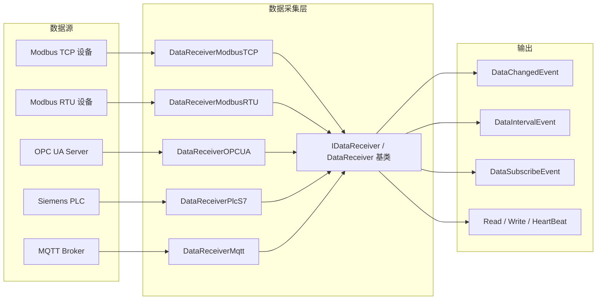

# data_receiver

**面向工业物联网（IIoT）的多协议数据采集与数据服务类库**

[](LICENSE)

[](https://github.com/iml6yu-tool/data_receiver/stargazers)
[](https://github.com/iml6yu-tool/data_receiver/issues)
[](https://github.com/iml6yu-tool/data_receiver/commits/main)

> 基于 .NET 6/7/8/9/10 的统一数据采集接收器（`DataReceiver`）与数据服务（`DataService`）类库。
> 一套抽象、多种协议：**Modbus TCP / Modbus RTU / OPC UA / Siemens S7 / MQTT**。

---

## 目录

- [简介](#简介)
- [功能特性](#功能特性)
- [支持的协议](#支持的协议)
- [架构概览](#架构概览)
- [项目结构](#项目结构)
- [快速开始](#快速开始)
- [配置说明](#配置说明)
- [核心 API](#核心-api)
- [事件模型](#事件模型)
- [数据服务（DataService）](#数据服务dataservice)
- [示例项目](#示例项目)
- [构建](#构建)
- [常见问题](#常见问题)
- [贡献](#贡献)
- [许可证](#许可证)

---

## 简介

`data_receiver` 提供了一套统一的工业设备数据采集抽象：无论底层是 Modbus、OPC UA、Siemens S7 还是 MQTT，上层业务都通过同一个 `IDataReceiver` 接口完成**连接、轮询、缓存、读取、写入、订阅与事件回调**。

同时项目还包含 `DataService`，可将数据以 **Modbus TCP/RTU 从站**或 **OPC UA 服务端**的形式对外提供，用于设备联调、数据回写与模拟。

核心目标：

- **协议无关**：业务代码只依赖统一接口与数据契约。
- **开箱即用**：与 `Microsoft.Extensions.DependencyInjection`、`ILogger`、`IConfiguration` 无缝集成。
- **配置驱动**：连接参数与点位（Node）均通过 JSON 配置，可按需加载或重新加载。
- **稳定可靠**：内置自动重连、数据缓存、变化检测、心跳检测与有界消息通道。

---

## 功能特性

| 特性 | 说明 |
| --- | --- |
| 统一抽象 | `IDataReceiver` / `IDataReceiver<TClient, TOption>` 屏蔽协议差异 |
| 多协议支持 | Modbus TCP、Modbus RTU、OPC UA、Siemens S7、MQTT |
| 依赖注入 | 各协议包提供 `AddReceiver(...)` / `AddMqttReceiver(...)` 扩展方法 |
| 自动重连 | `StartWorkAsync` 持续检测连接状态并按 `ReConnectPeriod` 自动重连 |
| 数据缓存 | 以地址为 Key 缓存最新值与时间戳，支持 `ReadAllAsync` / `ReadAsync` / `ReadsAsync` |
| 变化检测 | 仅当值发生变化时触发 `DataChangedEvent`，避免重复上报 |
| 定时轮询 | 按点位 `Interval` 周期读取并触发 `DataIntervalEvent` |
| 数据订阅 | `Subscribe(key, addresses)` 按业务 Key 订阅变化数据，最多 20 组、每组 100 个地址 |
| 读写能力 | 支持批量写、单点写、写入后校验（`WriteWithVerifyAsync`） |
| 心跳检测 | 依据配置的心跳点位判断 `Healthy / Degraded / Unavailable` |
| 有界通道 | 内部使用容量 5000 的 `Channel`，满时丢弃最旧数据并告警 |
| 多目标框架 | `net6.0` / `net7.0` / `net8.0` / `net9.0` / `net10.0` |
| 数据服务 | Modbus TCP/RTU 从站、OPC UA 服务端，支持默认值与心跳写入 |

---

## 支持的协议

### 数据采集（DataReceive）

| NuGet 包 | 协议 | 底层依赖 | 说明 |
| --- | --- | --- | --- |
| `iml6yu.DataReceive.Core` | - | `iml6yu.License` | 接收器核心抽象、配置模型、缓存与事件 |
| `iml6yu.DataReceive.ModbusMaster` | Modbus | `NModbus` 3.0.81 | Modbus 公共读取模型与类型定义 |
| `iml6yu.DataReceive.ModbusMasterTCP` | Modbus TCP | `NModbus` | Modbus TCP 主站采集 |
| `iml6yu.DataReceive.ModbusMasterRTU` | Modbus RTU | `NModbus.Serial`、`System.IO.Ports` | Modbus RTU 串口采集 |
| `iml6yu.DataReceive.OPCUA` | OPC UA | `OPCFoundation.NetStandard.Opc.Ua.Client` 1.5.377.22 | OPC UA 客户端采集 |
| `iml6yu.DataReceive.PLCSiemens` | Siemens S7 | 内置 `S7.Net` 源码 | 西门子 S7 系列 PLC 采集 |
| `iml6yu.DataReceive.Mqtt` | MQTT | `MQTTnet` 5.x（net8+）/ 4.3.7（net6/7） | MQTT 订阅采集，需自定义数据解析器 |
| `iml6yu.DataReceive.Mqtt.Default` | MQTT | 同上 | 按 `DataReceiveContract` 默认 JSON 格式解析 |
| `iml6yu.DataReceive.Mqtt.InPlant` | MQTT | 同上 | 中控 InPlant 数据格式解析 |

### 数据服务（DataService）

| NuGet 包 | 服务类型 | 说明 |
| --- | --- | --- |
| `iml6yu.DataService.Core` | - | 服务核心接口 `IDataService` 与配置模型 |
| `iml6yu.DataService.Modbus` | Modbus | Modbus 从站公共实现与数据存储 |
| `iml6yu.DataService.ModbusTCP` | Modbus TCP 从站 | 将数据以 Modbus TCP 从站对外提供 |
| `iml6yu.DataService.ModbusRTU` | Modbus RTU 从站 | 将数据以 Modbus RTU 从站对外提供 |
| `iml6yu.DataService.OpcUa` | OPC UA 服务端 | 将数据以 OPC UA 节点形式对外提供 |

---

## 架构概览



数据流：**采集 → 类型校验 → 缓存更新（变化检测）→ 有界通道 → 事件分发**。

---

## 项目结构

```
iml6yu.Data
├── doc/                             # 补充文档
├── src/
│   ├── iml6yu.Data.sln              # 解决方案
│   ├── Directory.Build.props        # 多目标框架与版本号
│   ├── iml6yu.DataCore/             # 数据契约与公共模型
│   │   └── iml6yu.Data.Core/
│   ├── iml6yu.DataReceive/          # 数据采集实现
│   │   ├── iml6yu.DataReceive.Core/           # 核心抽象
│   │   ├── iml6yu.DataReceive.ModbusMaster/   # Modbus 公共模型
│   │   ├── iml6yu.DataReceive.ModbusMasterTCP/
│   │   ├── iml6yu.DataReceive.ModbusMasterRTU/
│   │   ├── iml6yu.DataReceive.OPCUA/
│   │   ├── iml6yu.DataReceive.PLCSiemens/
│   │   ├── iml6yu.DataReceive.Mqtt/
│   │   ├── iml6yu.DataReceive.Mqtt.Default/
│   │   └── iml6yu.DataReceive.Mqtt.InPlant/
│   ├── iml6yu.DataService/          # 数据服务实现
│   │   ├── iml6yu.DataService.Core/
│   │   ├── iml6yu.DataService.Modbus/
│   │   ├── iml6yu.DataService.ModbusTCP/
│   │   ├── iml6yu.DataService.ModbusRTU/
│   │   └── iml6yu.DataService.OpcUa/
│   ├── iml6yu.Database/             # 数据库常量
│   ├── examples/                    # 可运行示例
│   └── test/                        # 测试与验证工程
├── LICENSE
└── README.md
```

版本号统一维护在 [Directory.Build.props](src/Directory.Build.props) 中，当前为 `2.0.2-beta261126001`。

---

## 快速开始

### 环境要求

- .NET SDK 10.0（类库多目标编译到 `net10.0`；仅运行示例时 .NET 8 SDK 即可）
- 可访问对应协议的设备或服务端

### 1. 安装 NuGet 包

以 Modbus TCP 为例：

```bash
dotnet add package iml6yu.DataReceive.ModbusMasterTCP
```

其他协议按需安装：

```bash
dotnet add package iml6yu.DataReceive.ModbusMasterRTU
dotnet add package iml6yu.DataReceive.OPCUA
dotnet add package iml6yu.DataReceive.PLCSiemens
dotnet add package iml6yu.DataReceive.Mqtt
```

> 如果 NuGet 上没有对应版本，可直接引用仓库中的源码项目。

### 2. 注册接收器（依赖注入）

```csharp
using iml6yu.DataReceive.ModbusMasterTCP;
using iml6yu.DataReceive.ModbusMasterTCP.Configs;

var builder = Host.CreateApplicationBuilder(args);

var option = builder.Configuration
    .GetSection("DataReceiverOption")
    .Get<DataReceiverModbusTCPOption>();

// isAutoLoadNodeConfig = true：从 option.NodeFile 加载点位配置
builder.Services.AddReceiver(option, isAutoLoadNodeConfig: true);
builder.Services.AddHostedService<Worker>();

var host = builder.Build();
host.Run();
```

### 3. 配置文件

`appsettings.json`：

```json
{
  "Logging": {
    "LogLevel": {
      "Default": "Information",
      "Microsoft.Hosting.Lifetime": "Information"
    }
  },
  "DataReceiverOption": {
    "originName": "",
    "originPwd": "",
    "originHost": "127.0.0.1",
    "originPort": 502,
    "reConnectPeriod": 10000,
    "reConnectTimes": 2,
    "connectTimeout": 60000,
    "receiverName": "warn_receiver",
    "nodeFile": "config/L01_P4.json",
    "autoConnect": false
  }
}
```

### 4. 点位配置（Node）

`config/L01_P4.json`：

```json
[
  {
    "fullAddress": "1.ReadInputRegisters2.0",
    "address": "CheckResults",
    "valueType": "Int32",
    "interval": 300,
    "groupName": "L01",
    "descript": ""
  }
]
```

### 5. 编写后台服务

```csharp
using iml6yu.DataReceive.ModbusMasterTCP;

public class Worker : BackgroundService
{
    private readonly ILogger<Worker> _logger;
    private readonly DataReceiverModbusTCP _receiver;

    public Worker(ILogger<Worker> logger, DataReceiverModbusTCP receiver)
    {
        _logger = logger;
        _receiver = receiver;
    }

    public override async Task StartAsync(CancellationToken cancellationToken)
    {
        _receiver.ConnectionEvent += (_, e) =>
            _logger.LogInformation("连接状态：{Connected} {Message}", e.IsConntion, e.Message);

        _receiver.ErrorEvent += (_, e) =>
            _logger.LogError(e.Ex, "采集异常：{Message}", e.Message);

        _receiver.DataChangedEvent += (_, e) =>
            _logger.LogInformation("数据变化：{Key} {Time} {Datas}",
                e.Key,
                DateTimeOffset.FromUnixTimeMilliseconds(e.Timestamp).ToString("yyyy-MM-dd HH:mm:ss.fff"),
                string.Join(",", e.Datas.Select(d => $"{d.Address}={d.Value}")));

        await _receiver.StartWorkAsync(cancellationToken);
        await base.StartAsync(cancellationToken);
    }

    public override async Task StopAsync(CancellationToken cancellationToken)
    {
        await _receiver.StopWorkAsync();
        await base.StopAsync(cancellationToken);
    }

    protected override Task ExecuteAsync(CancellationToken stoppingToken) => Task.CompletedTask;
}
```

### 6. 主动读写

```csharp
// 读取缓存中的单个点位
var value = await _receiver.ReadAsync("CheckResults");

// 主动读取设备（不经过缓存）
var direct = await _receiver.DirectReadAsync(new[]
{
    new DataReadItem { Address = "1.Coils.0", ValueType = TypeCode.Boolean }
});

// 写入单个点位
await _receiver.WriteAsync("1.Coils.4", true);

// 批量写入并校验
await _receiver.WriteWithVerifyAsync(new DataWriteContract
{
    Key = "biz-key",
    Datas = new[]
    {
        new DataWriteContractItem { Address = "1.HoldingRegistersDouble.6", Value = 12.34, ValueType = TypeCode.Double }
    }
});

// 订阅变化
_receiver.DataSubscribeEvent += (key, e) => { /* key 为订阅时的分组标识 */ };
_receiver.Subscribe("dashboard", new[] { "CheckResults", "1.Coils.0" });

// 心跳
var health = await _receiver.HeartBeatHealthy(); // Healthy / Degraded / Unavailable / UnKnown
```

其他协议注册方式一致，仅需替换 `Option` 与 `AddReceiver` 所在命名空间：

| 协议 | Option 类型 | 注册说明 |
| --- | --- | --- |
| Modbus TCP | `DataReceiverModbusTCPOption` | `services.AddReceiver(option, ...)` |
| Modbus RTU | `DataReceiverModbusRTUOption` | 额外配置 `comPort` / `baudRate` / `parity` / `dataBits` / `stopBit` |
| OPC UA | `DataReceiverOPCUAOption` | 地址使用 OPC UA 节点 ID（如 `ns=2;s=Tag`） |
| Siemens S7 | `DataReceiverPlcS7Option` | 额外配置 `cpuType` / `rack` / `slot` |
| MQTT | `DataReceiverMqttOption` | 使用 `AddMqttReceiver(option, dataParse, ...)` 传入数据解析器 |

MQTT 数据解析器示例：

```csharp
builder.Services.AddMqttReceiver(
    builder.Configuration.GetSection("GathererMqttOption").Get<DataReceiverMqttOption>(),
    json =>
    {
        if (string.IsNullOrEmpty(json)) return null;

        var data = JsonSerializer.Deserialize<InPlantMqttEntity>(json,
            new JsonSerializerOptions { PropertyNameCaseInsensitive = true });

        if (data?.RTValue == null) return null;

        return data.RTValue
            .Where(x => x.Value != null && !string.IsNullOrEmpty(x.Name))
            .GroupBy(x => x.Name)
            .ToDictionary(g => g.Key, g => new ReceiverTempDataValue(g.First().Value, g.First().Timestamp));
    },
    isAutoLoadNodeConfig: true);
```

更多 MQTT 配置示例见 [doc/readme.md](doc/readme.md)。

---

## 配置说明

### DataReceiverOption（所有协议的公共配置）

| 属性 | 类型 | 默认值 | 说明 |
| --- | --- | --- | --- |
| `ProductLineName` | `string` | - | 业务关联的产线名称 |
| `RefLineNames` | `string[]` | - | 需要联动复制的产线名称 |
| `OriginName` | `string` | - | 数据源用户名 |
| `OriginPwd` | `string` | - | 数据源密码 |
| `OriginHost` | `string` | - | 数据源 Host |
| `OriginPort` | `int?` | - | 数据源端口 |
| `ReConnectPeriod` | `int` | `30000` | 重连间隔（毫秒） |
| `ReConnectTimes` | `int` | `3` | 重连次数 |
| `ConnectTimeout` | `int` | `60000` | 连接超时（毫秒） |
| `ReceiverName` | `string` | - | 接收器名称 |
| `NodeFile` | `string` | - | 点位配置文件路径 |
| `HeartBeat` | `DataReadItem` | - | 心跳点位配置 |
| `AutoConnect` | `bool` | `false` | 是否在构造后自动连接 |

协议扩展配置：

- **Modbus RTU**：`ComPort`（串口号）、`BaudRate`（默认 `9600`）、`Parity`（默认 `None`）、`DataBits`（默认 `8`）、`StopBit`（默认 `One`）
- **Siemens S7**：`CpuType`（默认 `S71200`）、`Rack`（默认 `0`）、`Slot`（默认 `2`）
- **MQTT**：`DataInputTopics`（订阅的 Topic 列表）

### NodeItem（点位配置）

| 属性 | 说明 |
| --- | --- |
| `Address` | 业务地址（缓存与订阅的 Key） |
| `FullAddress` | 设备完整地址 |
| `ValueType` | 值类型，对应 `TypeCode` 枚举（JSON 中用字符串，如 `Int32`、`Boolean`） |
| `Descript` | 描述 |
| `GroupName` | 分组名称 |
| `Interval` | 定时读取间隔（毫秒，主动轮询专用） |
| `Count` | 读取长度，默认 `1` |

`ValueType` 支持：`Boolean`、`Char`、`SByte`、`Byte`、`Int16`、`UInt16`、`Int32`、`UInt32`、`Int64`、`UInt64`、`Single`、`Double`、`Decimal`、`DateTime`、`String`。

> 采集值与配置类型不匹配时，该条数据会被丢弃并记录警告日志。

### 地址格式

- **Modbus**：`<从站号>.<读写类型>.<起始地址>`，例如：
  - `1.ReadInputRegisters2.0`（读取 2 个寄存器的 32 位值）
  - `1.Coils.4`
  - `1.HoldingRegistersDouble.6`
- **Siemens S7**：以 PLC 地址表达，例如 `DB1.DTL126`、`DB102.DDT504`
- **OPC UA**：标准 NodeId，例如 `ns=2;s=Tag`

Modbus 读写类型包含大小端与字节交换变体（`HoldingRegisters2ByteSwap`、`HoldingRegistersFloatLittleEndian` 等），详见 [ModbusReadWriteType](src/iml6yu.DataReceive/iml6yu.DataReceive.ModbusMaster/DataTypes/Emuns.cs)。

---

## 核心 API

`IDataReceiver` 主要成员：

| 成员 | 说明 |
| --- | --- |
| `State` | 当前状态：`Reading` / `Ready` / `Working` / `Stoped` / `Error` / `Uninitialized` |
| `Name` | 接收器名称（取自 `ReceiverName`） |
| `IsConnected` | 是否已连接 |
| `LoadConfig(nodes)` / `LoadConfigAsync(file)` | 加载点位配置 |
| `ConnectAsync()` / `DisConnectAsync()` | 连接 / 断开 |
| `VerifyConnect()` | 校验当前连接状态 |
| `StartWorkAsync(token)` / `StopWorkAsync()` | 启动 / 停止采集与自动重连 |
| `ReadAllAsync()` | 读取缓存中的全部有效点位 |
| `ReadAsync(address)` / `ReadsAsync(addresses)` | 读取缓存中的指定点位 |
| `DirectReadAsync(items)` | 直接读取设备，不经过缓存 |
| `WriteAsync(contract)` / `WriteAsync(item)` / `WriteAsync<T>(address, value)` | 写入数据 |
| `WriteWithVerifyAsync(contract)` | 写入后读取校验（效率较低，但可确保准确性） |
| `Subscribe(key, addresses)` / `UnSubscrite(key)` | 订阅 / 取消订阅 |
| `HeartBeatHealthy()` | 心跳健康检查 |
| `SetDataParse(parser)` | 设置字符串数据解析器（MQTT 等场景） |

返回值统一使用 `iml6yu.Result` 中的 `MessageResult`、`DataResult<T>`、`CollectionResult<T>`，便于判断成功状态与错误信息。

如需按程序集与类型名动态创建接收器，可使用 `DataReceiverFactory.Create(...)`。

---

## 事件模型

| 事件 | 参数 | 触发时机 |
| --- | --- | --- |
| `ConnectionEvent` | `ConnectArgs` | 连接状态变化 |
| `ErrorEvent` | `ExceptionArgs` | 类库内部发生异常 |
| `WarnEvent` | `WarnArgs` | 类库内部发生警告 |
| `DataChangedEvent` | `DataReceiveContract` | 点位值发生变化 |
| `DataIntervalEvent` | `DataReceiveContract` | 按点位 `Interval` 定时读取 |
| `DataSubscribeEvent` | `DataReceiveContract` | 订阅的点位值发生变化，`sender` 为订阅 Key |

数据契约 `DataReceiveContract`：

| 属性 | 说明 |
| --- | --- |
| `Id` | 唯一 ID，可用于重传判定 |
| `Key` | 产线 / 业务分组名称 |
| `Timestamp` | 毫秒时间戳 |
| `Datas` | `DataReceiveContractItem` 列表（`Address`、`Value`、`ValueType`、`Timestamp`） |

---

## 数据服务（DataService）

`IDataService` 用于将数据以标准协议对外提供：

| 成员 | 说明 |
| --- | --- |
| `Name` / `IsRuning` | 服务名称 / 运行状态 |
| `StartServicer(token)` / `StopServicer()` | 启动 / 停止服务 |
| `WriteAsync(contract)` / `WriteAsync(item)` / `WriteAsync<T>(address, value)` | 写入服务端数据 |

### Modbus TCP 从站

```csharp
using iml6yu.DataService.Core.Configs;
using iml6yu.DataService.ModbusTCP;
using iml6yu.DataService.ModbusTCP.Configs;

var option = new DataServiceModbusOptionTCP
{
    IPAddress = "0.0.0.0",
    Port = 502,
    ServiceName = "ModbusSlave",
    Storages = new List<DataServiceStorageOption>
    {
        new()
        {
            Id = "1", // 从站号
            Heart = new HeartOption
            {
                HeartType = HeartType.Number,
                HeartAddress = "1.HoldingRegisters.0",
                HeartInterval = 1
            },
            DefaultValues = new List<DataServiceStorageDefaultObjectItem>
            {
                new() { Address = "1.HoldingRegisters.1", DefaultValue = 100, ValueType = TypeCode.Int32 }
            }
        }
    }
};

var service = new DataServiceModbusTCP(option);
service.StartServicer(CancellationToken.None);
```

地址格式与采集端一致：`<从站号>.<读写类型>.<起始地址>`。

### OPC UA 服务端

`appsettings.json`：

```json
{
  "option": {
    "IPAddress": "localhost",
    "Port": 4840,
    "ServiceName": "Test",
    "Storages": [
      {
        "Id": "DataServiceTest001",
        "Heart": {
          "HeartType": "Number",
          "HeartAddress": "ns=2;HeartNumber",
          "HeartInterval": 1000
        },
        "DefaultValues": [
          { "Address": "ns=2;TestBoolean1", "DefaultValue": true, "ValueType": "Boolean" },
          { "Address": "ns=2;TestInt1", "DefaultValue": 1, "ValueType": "Int32" },
          { "Address": "ns=2;TestDouble1", "DefaultValue": 1.0001234, "ValueType": "Double" },
          { "Address": "ns=2;TestString", "DefaultValue": "iml6yu", "ValueType": "String" }
        ]
      }
    ]
  }
}
```

心跳类型：

- `Number`：数字递增，到达最大值后归零
- `OddAndEven`：奇偶交替（0 / 1）
- `Time`：写入当前时间的分秒数字

---

## 示例项目

| 示例 | 说明 |
| --- | --- |
| [iml6yu.DataReceiverExample.S7](src/examples/iml6yu.DataReceiverExample) | 西门子 S7 采集（控制台 + `BackgroundService`） |
| [iml6yu.DataReceiverExample.ModbusTCP](src/examples/iml6yu.DataReceiverExample.ModbusTCP) | Modbus TCP 采集与读写 |
| [iml6yu.DataReceiverExample.ModbusRtu](src/examples/iml6yu.DataReceiverExample.ModbusRtu) | Modbus RTU 串口采集 |
| [iml6yu.DataReceiverExample.S7.Winform](src/examples/iml6yu.DataReceiverExample.S7.Winform) | WinForm 界面演示 |
| [iml6yu.DataServiceExample.ModbusTCP](src/examples/iml6yu.DataServiceExample.ModbusTCP) | Modbus TCP 从站服务（WinForm） |
| [iml6yu.DataServiceExample.OpcUa](src/examples/iml6yu.DataServiceExample.OpcUa) | OPC UA 服务端示例 |

运行示例：

```bash
dotnet run --project src/examples/iml6yu.DataReceiverExample.ModbusTCP
```

---

## 构建

```bash
dotnet restore src/iml6yu.Data.sln
dotnet build src/iml6yu.Data.sln -c Release
```

类库默认多目标框架编译（`net6.0` ~ `net10.0`），示例项目大多面向 `net8.0`（部分 WinForm 示例为 `net8.0-windows` 或 `net48`）。

---

## 常见问题

**Q：采集没有数据？**

检查点位 `Address` / `FullAddress` 是否与设备地址一致，`ValueType` 是否匹配；值类型不一致时数据会被丢弃并输出警告日志。

**Q：如何只接收变化的数据？**

监听 `DataChangedEvent`；需要按业务分组接收时使用 `Subscribe(key, addresses)` + `DataSubscribeEvent`。

**Q：如何定时上报？**

为点位配置 `Interval`，监听 `DataIntervalEvent`。该事件会按周期返回本次采集到的有效点位。

**Q：MQTT 采集收不到数据？**

确认 `DataInputTopics` 已配置、`dataParse` 解析结果以点位地址为 Key；默认 MQTT 包要求消息体为 `DataReceiveContract` JSON 格式。

---

## 贡献

欢迎通过 [Issue](https://github.com/iml6yu-tool/data_receiver/issues) 反馈问题或提出需求：

1. Fork 本仓库并新建分支：`feature/your-feature`
2. 保持代码风格与现有实现一致，补充必要注释
3. 提交 Pull Request，并说明改动内容与验证方式

---

## 许可证

本项目基于 [MIT License](LICENSE) 开源。

- GitHub：<https://github.com/iml6yu-tool/data_receiver>
- Gitee：<https://gitee.com/iml6yu/data_receiver>
